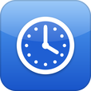

# AppTime

Per-app screen time for iOS 6: Today, Last 7 Days and All Time in Settings, counted only while the screen is on and unlocked.

## Features

- Counts time in each app while the screen is on and unlocked.
- Today, Last 7 Days and All Time, with each app's icon.
- Reset whenever you like.

## How to use

1. Use your iPhone as usual.
2. Settings › App Time shows Today, Last 7 Days and All Time. Reset is there too.

## Requirements

- Jailbroken iOS 6 (tested on an iPhone 5 with iOS 6.1.2)
- Cydia Substrate and PreferenceLoader (Cydia installs them for you)

## Install

In Cydia, add `https://mbucc9000.github.io/slopkit/` and install **AppTime**. Or download the `.deb` from [Releases](../../releases) and install it with `dpkg -i`.

## Building

[Theos](https://theos.dev) with the iOS 6.1 SDK: `make package FINALPACKAGE=1`.

## License

MIT.
